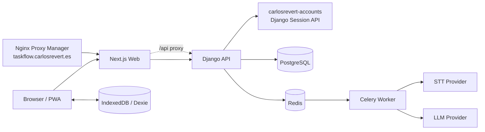
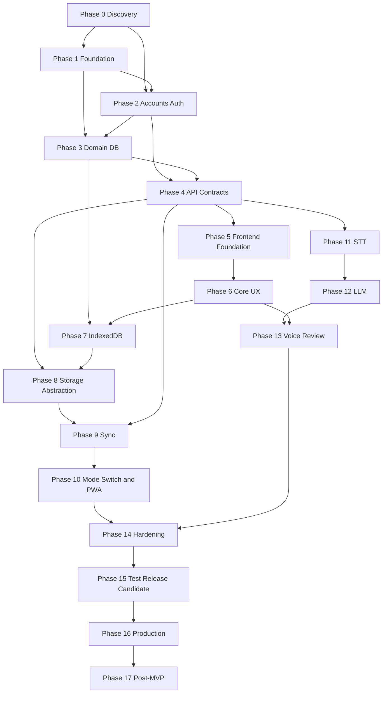

# TaskFlow - Roadmap de Implementacion

**Version:** 1.0
**Estado:** Plan ejecutable previo a implementacion
**Producto:** Gestor personal inteligente de tareas, Web App/PWA
**Repositorio objetivo:** `/home/revert/Repositorios/TaskFlow`
**Autoridad de identidad:** `carlosrevert-accounts`
**Ultima revision:** 2026-09-15

## Como usar este documento

Este archivo es el plan maestro de implementacion, la fuente de tickets y el contrato de calidad del proyecto. Cada fase debe cerrarse antes de iniciar la siguiente fase dependiente. Las tareas pueden convertirse directamente en Issues/Jira conservando su identificador `TF-*`.

Reglas operativas:

1. No implementar una tarea sin cumplir sus prerrequisitos.
2. Cada tarea debe dejar tests, documentacion y evidencia de validacion.
3. Un `QUALITY GATE` fallido bloquea la siguiente fase.
4. Los cambios de alcance se registran en `Decisiones cerradas` y no se introducen silenciosamente.
5. Los cambios de schema siempre incluyen migracion, prueba de migracion y consideracion de rollback.
6. No modificar `carlosrevert-accounts` para facilitar TaskFlow sin una decision aprobada y una justificacion de compatibilidad.
7. Cada subfase importante termina en un commit pequeno y trazable.
8. Una fase solo puede depender de fases anteriores; nunca se usa una validacion
     de una fase posterior como prerrequisito de implementacion.
9. Las integraciones externas se prueban primero con fixtures/fakes contractuales.
     La validacion real de staging se ejecuta en la fase de smoke/deployment que
     la posee y no bloquea fases de desarrollo anteriores.
10. El aislamiento se valida junto al recurso que lo introduce: dominio, API,
        sync, voz, snapshots y hardening. No se exige probar recursos que aun no
        existen.

### Regla de dependencias y quality gates

Cada tarea tiene una **fase de implementacion** y, cuando aplique, una
**validacion posterior**. La fase de implementacion se cierra con tests
deterministas usando dobles o fixtures; la validacion posterior aporta
evidencia adicional en la fase que dispone del entorno o del recurso real.

Por tanto:

- un `QUALITY GATE` solo contiene comprobaciones realizables con el codigo y
    contratos disponibles hasta esa fase;
- staging, smoke post-deploy, backups, restore drills y pruebas con dos
    dispositivos pertenecen a las fases de testing/deployment correspondientes;
- una validacion posterior pendiente se registra como `DEFERRED`, nunca como
    `BLOCKED`, salvo que impida implementar la propia tarea;
- si una tarea abarca varios recursos futuros, se divide en tareas de ownership
    locales y una auditoria consolidada posterior.

Leyenda:

- **P0:** bloqueador o fundamento.
- **P1:** requerido para MVP.
- **P2:** importante, puede seguir al MVP.
- **P3:** post-MVP.
- **Risk:** riesgo tecnico o de producto de la tarea.
- `CONFIRMED`: verificado en el repositorio o en el informe.
- `UNKNOWN`: no demostrado por el codigo actual; requiere discovery.
- `DECISION CERRADA`: estrategia aprobada y obligatoria salvo ADR posterior.

---

## Executive Summary

TaskFlow sera una aplicacion de tareas centrada en la captura rapida: crear manualmente o convertir una entrada de voz en tareas estructuradas, organizadas en listas y visibles como pendientes. El historial registrara las tareas completadas sin competir con la vista principal.

La primera version se construira como un monorepo pragmatico con:

```text
Next.js + React + TypeScript
        |
        v
Django + Django REST Framework
        |
        +-- PostgreSQL
        +-- Redis
        +-- Celery
        +-- IndexedDB/Dexie en el navegador
```

La identidad se delega a `carlosrevert-accounts`. La integracion real no sera JWT ni OAuth: Accounts usa sesion Django con cookie HttpOnly compartida para `*.carlosrevert.es`, `credentials: include` y CSRF para mutaciones. TaskFlow debe adaptar ese contrato mediante un `AccountsSessionAdapter`; nunca debe leer ni validar localmente la cookie de sesion de Accounts con un secreto duplicado.

El MVP se entrega en este orden:

1. Discovery y contrato de Accounts.
2. Foundation reproducible.
3. Adaptador de autenticacion y aislamiento multiusuario.
4. Dominio y API CRUD.
5. UX manual completa.
6. Persistencia local y modos Cloud/Device.
7. Sincronizacion fiable.
8. PWA y offline.
9. STT, LLM, revision y routing inteligente.
10. Hardening y despliegue de produccion.

---

## Architecture Principles

### Separacion por capas

```text
Presentation
    -> Application
        -> Domain
            -> Repository interfaces
                -> Infrastructure / Persistence
```

- **Presentation:** paginas, componentes, hooks y DTO mapping. No contiene reglas de dominio ni llamadas directas a IndexedDB.
- **Application:** casos de uso como `CreateTask`, `CompleteTask`, `ProcessVoiceSession` y `SyncData`.
- **Domain:** entidades, invariantes, value objects, eventos y puertos.
- **Infrastructure:** clientes REST, adaptador Accounts, Dexie, proveedores STT/LLM, Celery y observabilidad.
- **Persistence:** modelos Django, migraciones, indices y transacciones PostgreSQL.

### Reglas de dependencia

- Los componentes React no importan `fetch`, Dexie, Django ni SDKs de IA directamente.
- Las views DRF solo autentican, validan DTOs y delegan en casos de uso.
- Los serializers no contienen reglas de negocio complejas.
- Los modelos no invocan proveedores externos.
- Los proveedores STT/LLM implementan interfaces propias.
- La UI consume `StorageManager`, no conoce Cloud o Device.
- Todo recurso cloud se filtra por la identidad autenticada en el servidor.

### Pragmatismo

- Monolito modular Django, no microservicios iniciales.
- PostgreSQL como unica base cloud.
- Redis solo cuando exista una necesidad concreta de cache, rate limit distribuido o broker Celery.
- Event log de negocio minimo y utilizable; no convertir cada operacion interna en un sistema distribuido.
- `Last Write Wins` para el MVP, documentado y testeado.

### Type safety y contratos

- TypeScript `strict`.
- Python con typing y lint configurado.
- OpenAPI como contrato HTTP versionado.
- JSON Schema para snapshots, sync y salida LLM.
- Tipos TypeScript generados o derivados del contrato, nunca duplicados manualmente sin test de contrato.

---

## Current Repository Assessment

### TaskFlow

**CONFIRMED:** el repositorio contiene la foundation ejecutable, el adapter de
Accounts y el cliente web de autenticacion implementados. Aun no contiene el
dominio de listas/tareas ni la API CRUD, que siguen siendo trabajo pendiente.

La siguiente estructura es la estructura objetivo completa; las rutas ya
existentes deben preservarse y las pendientes se crean en su fase propietaria:

```text
apps/web/
apps/api/
packages/contracts/
packages/schemas/
infra/
docs/
tests/
```

### Informes de producto y arquitectura

Los informes fijan el producto y el stack, pero contienen afirmaciones que deben quedar condicionadas a este roadmap:

- PostgreSQL se ejecutara en la version fijada por la imagen aprobada en Foundation; el roadmap no obliga a cambiar la version de Accounts.
- Se propone Next.js 16 y Django 5.2 LTS; las versiones exactas del nuevo repositorio se fijaran en Foundation mediante lockfiles y CI.
- Se propone un API de autenticacion local, pero Accounts no ofrece JWT/OAuth. El contrato real de sesion prevalece.
- Se propone `user_id` externo; el endpoint real `/api/v1/auth/me/` devuelve `id` de usuario Django. Se usara como `external_user_id` y no se creara una tabla de contraseñas en TaskFlow.

---

## Carlos Revert Accounts: inspeccion real

### Hechos confirmados

Fuente principal: el codigo y documentacion de `/home/revert/Repositorios/carlosrevert-accounts`.

| Area | Hecho verificado |
|---|---|
| Framework | Django `5.2.16`, DRF `3.16.0`, Python objetivo `3.12` en Ruff/Docker |
| Usuario | `apps.users.models.User`, hereda `AbstractUser`, email unico, `email_verified`, `is_blocked`, `is_active` |
| Backend auth | `EmailOrUsernameModelBackend` + `django-axes` |
| Sesion | `django.contrib.sessions`, `SessionAuthentication`, cookie HttpOnly |
| Token | No existe JWT, OAuth, OIDC ni endpoint de introspeccion de bearer token |
| Cookie produccion | `SESSION_COOKIE_DOMAIN=.carlosrevert.es`, Secure, HttpOnly, SameSite=Lax |
| CSRF | `CsrfViewMiddleware`, cookie compartida configurable y `GET /api/v1/auth/csrf/` |
| CORS | lista explicita, `CORS_ALLOW_CREDENTIALS=True` |
| User introspection | `GET /api/v1/auth/me/`, publico, devuelve `authenticated` y `user` |
| User payload | `id`, `username`, `email`, `email_verified`, `first_name`, `last_name`, `plan` |
| Login | `POST /api/v1/auth/login/`, inicia sesion y devuelve usuario |
| Logout | `POST /api/v1/auth/logout/`, requiere sesion y CSRF |
| Registro | `POST /api/v1/auth/register/`, luego verificacion de email |
| Email | `POST /api/v1/auth/verify-email/`; codigo de 6 digitos y sesion al verificar |
| Cuota | `/api/v1/usage/*`, sesion para reserva/consulta; callbacks internos con claves de aplicacion |
| Servicio interno | `X-Application-Slug` + `X-Service-Key`, hash de clave en DB, no es auth de usuario |
| Health | `/health/`, comprueba PostgreSQL y devuelve 503 si falla |
| OpenAPI | `/api/schema/`, Swagger `/api/docs/`, Redoc `/api/redoc/` |
| TaskFlow production | `taskflow.carlosrevert.es`, Nginx Proxy Manager hacia frontend `10700`, API interna `10701` |
| Tests | pytest, cobertura minima 80%, tests de auth, permisos, hardening y cuota |
| Privacidad | no registrar contrasenas, cookies, claves, prompts, respuestas ni audio |

### Endpoints utilizables por TaskFlow

La siguiente tabla describe solo endpoints confirmados. No asumir que Accounts ofrecera endpoints adicionales.

| Endpoint | Uso TaskFlow | Auth/CSRF |
|---|---|---|
| `GET /api/v1/auth/csrf/` | obtener cookie CSRF antes de mutaciones contra Accounts | publico; `credentials: include` |
| `GET /api/v1/auth/me/` | comprobar sesion y obtener identidad | publico; cookie de sesion |
| `POST /api/v1/auth/login/` | UI de login si TaskFlow decide ofrecerla via Accounts | cookie + CSRF |
| `POST /api/v1/auth/logout/` | cerrar sesion global | cookie + CSRF |
| `POST /api/v1/auth/register/` | alta delegada | cookie + CSRF |
| `POST /api/v1/auth/verify-email/` | verificar email | cookie + CSRF |
| `POST /api/v1/auth/verify-email/resend/` | reenviar codigo | cookie + CSRF |
| `GET /api/v1/usage/summary/` | opcional, si la UX muestra cuota | cookie de sesion |
| `GET /health/` | monitorizar Accounts desde infraestructura autorizada | no asumir que es readiness completo |

### Incompatibilidades y resolucion

#### I-001: JWT/OAuth propuesto frente a sesion real

- **Problema:** el informe tecnico sugiere `access token`, refresh o JWKS como contrato ideal; Accounts no implementa ninguno.
- **Resolucion MVP:** usar cookie de sesion compartida y un adaptador server-side que llame a `/api/v1/auth/me/` con la cookie recibida.
- **No permitido:** duplicar `SECRET_KEY`, parsear la cookie de Django en TaskFlow, aceptar `user_id` del navegador o inventar JWT.
- **Riesgo:** una llamada a Accounts por peticion puede introducir latencia o dependencia de disponibilidad.
- **Mitigacion:** cliente HTTP con timeout corto, sin cache de identidad en MVP, circuit breaker prudente y fallo cerrado para datos privados. La ausencia de cache evita mezclar sesiones y mantiene la revocacion inmediata.
- **Decision cerrada:** usar `https://taskflow.carlosrevert.es` como origen unico para el usuario. Nginx Proxy Manager envia el dominio al frontend `10700`; Next.js proxifica `/api/*` hacia Django API `10701`. No se expone CORS de TaskFlow al navegador.

#### I-002: Cookie de Accounts no es validable por TaskFlow

- **Problema:** la cookie es firmada por Django Accounts y el secreto no debe copiarse.
- **Resolucion:** `AccountsSessionAdapter` obtiene `Cookie` de la peticion, invoca `/auth/me/`, valida `authenticated=true` y normaliza `user.id`.
- **Condicion:** no se cachea `/me/` en CDN, Next.js, Redis ni memoria compartida durante el MVP.

#### I-003: CSRF del dominio de Accounts y CSRF propio

- **Problema:** el token CSRF de Accounts esta ligado al secreto/cookie de Accounts; TaskFlow no debe intentar verificarlo con sus claves.
- **Resolucion cerrada:** el frontend nunca llama directamente a Accounts. Next.js envia `/api/accounts/*` al backend TaskFlow y Django usa un `AccountsAuthProxy` server-side para reenviar cookie, CSRF y respuestas sin exponer secretos. TaskFlow valida su propio CSRF en mutaciones de `/api/v1/*`; el proxy obtiene y reenvia el CSRF requerido por Accounts para sus POST.

#### I-004: `/internal/usage/validate/` devuelve `user_id`, pero no autentica TaskFlow

- **Problema:** el endpoint es para validar reservas de cuota y exige una clave de aplicacion; no sustituye `/auth/me/`.
- **Resolucion:** TaskFlow separara `AccountsSessionAdapter` de `AccountsQuotaClient`. Cada flujo que use STT/LLM reservara una unidad antes de procesamiento y notificara `complete` o `fail`; las tareas manuales no consumiran cuota.
- **Configuracion Accounts:** registrar `taskflow` como `ClientApplication` activa y consumidora de cuota, rotar su clave desde Admin y guardarla solo en API/worker.

### Contrato TaskFlow-Accounts que debe documentarse y verificarse

Crear en Phase 0 `docs/architecture/accounts-integration.md` con:

1. Diagrama de secuencia login, `/me/`, peticion privada y logout.
2. Reglas de cookies, dominios, `credentials`, CSRF y CORS.
3. Mapeo `Accounts.User.id -> TaskFlow.external_user_id`.
4. Estados: anonimo, autenticado, email no verificado, bloqueado, desactivado, Accounts no disponible.
5. Politica de timeout, cache y fallo cerrado.
6. Forma de login/logout y redireccion segura.
7. Contrato de cuota para `taskflow`, incluyendo acciones AI, reembolso `before_processing` y clave interna.
8. Limitaciones: no token portable, no introspeccion JWT, no SSO fuera de dominios compatibles.

### Cambios permitidos en `carlosrevert-accounts`

El roadmap no requiere modificar modelos, migraciones, contraseñas, backend de autenticación ni cookies de Accounts. Solo se permite este checklist operativo:

- **MODIFY `.env`/entorno de producción:** añadir `https://taskflow.carlosrevert.es` a `CSRF_TRUSTED_ORIGINS`.
- **MODIFY `.env`/entorno de producción:** mantener `SESSION_COOKIE_DOMAIN=.carlosrevert.es`, `SESSION_COOKIE_SECURE=true` y `CSRF_COOKIE_SECURE=true`.
- **MODIFY configuración de CORS solo si se necesita para una operación administrativa futura:** conservar allowlist explícita; el navegador de TaskFlow no dependerá de CORS.
- **CREATE datos de integración en Admin:** `ClientApplication` con slug `taskflow`, URL `https://taskflow.carlosrevert.es`, activa y `consumes_quota=true`.
- **CREATE secreto operativo:** rotar la service key de `taskflow` desde Admin y guardarla únicamente en los secretos de API/worker TaskFlow.
- **VALIDATE:** login, verificación, logout, `/auth/me/`, reserva, validación, complete/fail y revocación de sesión desde staging.

No se debe crear un usuario TaskFlow en Accounts ni registrar una contraseña, JWT, OAuth client o endpoint adicional para satisfacer este roadmap.

---

## System Architecture



### Boundary rules

- Browser -> TaskFlow API: HTTPS; cookie/session context forwarded only as required; CSRF propio para mutaciones.
- TaskFlow API -> Accounts: HTTPS interno o same-origin proxy; forwarding controlado de la cookie de Accounts; timeout y no logging de cookies.
- TaskFlow API -> PostgreSQL: ORM, transacciones y filtros por `external_user_id`.
- Worker -> STT/LLM: credenciales solo en entorno backend/worker; audio temporal; salida schema-first.
- Browser -> IndexedDB: solo a traves de repositorios Dexie.

### Topologia inicial

Un servicio web Next.js, un servicio API Django, un worker Celery, PostgreSQL y Redis. Nginx Proxy Manager termina TLS y enruta. No se desplegara Kubernetes ni microservicios independientes en el MVP.

---

## Requirements Matrix

| ID | Requisito | Fase | Prioridad | Estado inicial | Evidencia de cierre |
|---|---|---:|---:|---|---|
| REQ-001 | Identidad delegada a Accounts | 2, 15, 16 | P0 | Pending | fixtures de `/me/`, E2E y smoke staging |
| REQ-002 | Listas con Inbox permanente | 3, 6 | P1 | Pending | migracion, API y smoke UI |
| REQ-003 | CRUD de tareas pendientes | 3, 4, 6 | P0 | Pending | tests dominio/API/E2E |
| REQ-004 | Completar y reabrir sin perder historial | 3, 6 | P0 | Pending | eventos y tests de transaccion |
| REQ-005 | Historial global y por lista | 3, 4, 6 | P1 | Pending | paginacion, filtros y E2E |
| REQ-006 | Event log minimo | 3 | P1 | Pending | eventos esperados e idempotencia |
| REQ-007 | Device Mode con IndexedDB/Dexie | 7, 8 | P1 | Pending | matriz offline y migracion Dexie |
| REQ-008 | Cloud Mode con replica local | 8 | P1 | Pending | StorageManager y sincronizacion |
| REQ-009 | Sync batch, cursor e idempotencia | 9 | P1 | Pending | dos dispositivos y reintentos |
| REQ-010 | Cloud -> Device sin perdida | 10 | P1 | Pending | snapshot, checksum y rollback |
| REQ-011 | Device -> Cloud sin perdida | 10 | P1 | Pending | merge y conflictos |
| REQ-012 | PWA instalable y offline | 10 | P1 | Pending | manifest, service worker y Playwright |
| REQ-013 | Captura manual menor a un flujo largo | 6 | P0 | Pending | test E2E de Enter y feedback inmediato |
| REQ-014 | Captura de audio temporal | 11 | P1 | Pending | limites, limpieza y test de fallo |
| REQ-015 | STT desacoplado | 11 | P1 | Pending | fake provider y contrato |
| REQ-016 | Extraccion LLM JSON validado | 12 | P1 | Pending | schema, malformed JSON y retry |
| REQ-017 | Smart routing con Inbox fallback | 13 | P1 | Pending | listas disponibles y listas inventadas |
| REQ-018 | Voice Review editable | 13 | P1 | Pending | editar/eliminar/mover antes de crear |
| REQ-019 | Seguridad multi-tenant | 3, 4, 9, 10, 11, 14 | P0 | Pending | ownership por recurso, A/B y UUID guessing |
| REQ-020 | Health/readiness y observabilidad | 1, 14, 16 | P1 | Pending | endpoints, logs estructurados y alertas |
| REQ-021 | CI/CD reproducible | 1, 15, 16 | P0 | Pending | pipeline verde y build Docker |
| REQ-022 | Backup, export, reset seguro | 14, 16 | P1 | Pending | restore drill y confirmacion fuerte |
| REQ-023 | Theme Engine y Stark inicial | 5 | P1 | Pending | tokens, contraste y segundo theme de prueba |
| REQ-024 | Accesibilidad responsive | 5, 6, 10, 15 | P1 | Pending | teclado, lector, mobile y reduced motion |

---

## Architecture Traceability

| Decision | Fases | Implementacion / evidencia |
|---|---|---|
| Accounts real como autoridad de identidad | 0, 2, 16 | contrato, `AccountsSessionAdapter`, smoke staging |
| No JWT inventado | 0, 2, 16 | test de forwarding `/me/`, contrato y smoke |
| Next.js + TypeScript strict | 1, 5 | `apps/web`, tsconfig y CI |
| Django + DRF modular | 1, 3, 4 | `apps/api`, OpenAPI y servicios |
| PostgreSQL | 1, 3 | compose, migraciones y health |
| Redis + Celery solo para async | 1, 11, 12 | worker y jobs de voz |
| Repository Pattern | 7, 8 | puertos, CloudRepository y LocalRepository |
| IndexedDB mediante Dexie | 7 | `infrastructure/indexeddb` |
| Cloud/Device por StorageManager | 8, 10 | tests de cambio de modo |
| Sync LWW e idempotente | 9 | cursor, operaciones y conflict resolver |
| Event log de dominio | 3, 4, 6 | `TaskEvent` y timeline |
| AI providers intercambiables | 11, 12 | `SpeechToTextProvider`, `TaskExtractionProvider` |
| JSON Schema para AI/snapshots | 9, 10, 12 | schemas versionados y contract tests |
| Theme Engine | 5 | tokens y ThemeProvider |
| PWA/offline | 10 | manifest, service worker, Playwright |
| Multi-tenancy por recurso | 3, 4, 9, 10, 11, 14 | ownership tests, UUID policy y security review |

---

# PHASE 0 - Discovery & Architectural Validation

**Objective:** convertir los informes y el contrato real de Accounts en decisiones implementables antes de crear codigo.

**Depends on:** ninguno.

**Risk:** Critical, por dependencia de identidad y cookies.

**Status:** COMPLETED. Discovery, contrato de Accounts, topologia, cuota, ADRs y riesgos estan documentados y verificados. La prueba HTTPS real se reserva para el smoke de staging de Phase 16; no bloquea las fases de discovery, foundation o desarrollo.

### 0.1 - Inventario reproducible

**TF-0001 [P0]** Confirmar estado de los repositorios, ramas, licencias operativas, comandos disponibles y ausencia de codigo TaskFlow existente.

- **CREATE:** `docs/architecture/repository-inventory.md`.
- **Implementacion:** registrar rutas reales, versiones locales, politicas de secretos y comandos de CI candidatos.
- **Validar:** inventario reproducible por otra persona; no incluir valores de `.env`.

**TF-0002 [P0]** Inspeccionar `carlosrevert-accounts` completo en las areas de estructura, dependencias, settings, urls, usuario, auth backend, middleware, permisos, cookies, CSRF, CORS, API, Docker, env y tests.

- **Evidencia verificada:** Django 5.2.16, Python 3.12, `SessionAuthentication`, `/api/v1/auth/me/`, cookie `.carlosrevert.es`, CSRF, no JWT/OAuth.
- **Validar:** cada afirmacion del contrato enlaza a un archivo existente; lo no verificado queda `UNKNOWN`.

### 0.2 - Contrato de Accounts

**TF-0003 [P0]** Producir el entregable obligatorio de integracion.

- **CREATE:** `docs/architecture/accounts-integration.md`.
- **Debe contener:** endpoints confirmados, payload `/me/`, mapeo de identidad, cookies, CSRF, CORS, login, logout, email verification, estados de error, timeouts y limitaciones.
- **No hacer:** inventar bearer tokens, refresh tokens, JWKS o endpoints.
- **Acceptance:** un implementador puede construir el adapter sin consultar los informes originales.

**TF-0004 [P0]** Decidir el limite de red del API: same-origin `/api/*` o subdominios con CORS.

- **Decision cerrada:** `https://taskflow.carlosrevert.es` es el unico origen del navegador. Nginx Proxy Manager apunta al frontend en `10700`; Next.js reenvia `/api/*` al API Django en `10701`. El navegador no llama a TaskFlow API ni a Accounts mediante CORS.
- **Validar en esta fase:** topologia, allowlist y forwarding mediante fixtures.
- **Validacion diferida:** smoke HTTPS real de login, `/auth/me/`, logout global,
  CSRF y refresh en Phase 16.

**TF-0005 [P1]** Definir si TaskFlow consume cuota de Accounts.

- **Decision cerrada:** si una operación invoca STT/LLM consume una unidad; la creación, edición, movimiento y completado manual no consumen cuota.
- **Accounts:** crear/activar `ClientApplication(slug="taskflow", consumes_quota=true)`, rotar la clave interna desde Admin y guardar el secreto únicamente en API/worker.
- **Contrato:** reservar con `request_id` UUID antes de iniciar IA; validar la reserva desde backend; llamar `complete` o `fail` una sola vez. `before_processing` es el único fallo inicialmente reembolsable.
- **Acceptance:** ninguna llamada a STT/LLM se ejecuta si Accounts no autoriza la reserva; un retry no duplica consumo.

### 0.3 - Contratos y ADR iniciales

**TF-0006 [P1]** Crear ADRs solo para decisiones ya estables.

- **CREATE:** `docs/decisions/ADR-001-accounts-session-integration.md`, `ADR-002-modular-monolith.md`, `ADR-003-repository-and-storage-modes.md`.
- **Validar:** cada ADR incluye contexto, decision, alternativas, consecuencias y estado.

**TF-0007 [P1]** Crear matriz inicial de riesgos y decisiones abiertas.

- **CREATE:** `docs/architecture/risk-register.md`.
- **Incluye:** Accounts unavailable, cookie/CSRF, sync conflict, AI provider failure, local DB migration, data loss y coste de audio/LLM.

### Tests y QA

- Test documental de enlaces/rutas de Accounts.
- Smoke manual de `/api/v1/auth/me/` anonimo y autenticado en entorno de prueba.
- No usar el `.env` real en evidencias ni logs.
- **Evidencia local completada:** Accounts `/health/` devuelve `200`, `/api/v1/auth/me/` anonimo devuelve `200`, el contenedor esta `healthy`, y `CSRF_TRUSTED_ORIGINS`/`CORS_ALLOWED_ORIGINS` incluyen `https://taskflow.carlosrevert.es`.
- **Evidencia de cuota completada:** `taskflow` esta activo, consume cuota, tiene hash de credencial provisionado y la credencial se valida contra Accounts sin exponer su valor.
- **Validacion diferida a Phase 16:** login, logout, CSRF y refresh desde
    `taskflow.carlosrevert.es`, cuando exista el entorno de staging desplegado.

### QUALITY GATE

- [x] `accounts-integration.md` aprobado.
- [x] No hay afirmaciones de auth sin evidencia.
- [x] Topologia same-origin y puertos registrados.
- [x] `taskflow` registrado en Accounts y clave interna provisionada en staging.
- [x] Riesgos Critical tienen mitigacion o blocker explicito.

**Excepcion documentada:** el smoke HTTPS completo se ejecuta en Phase 16,
cuando existen la aplicacion desplegada y los fixtures operativos de staging.
No es un blocker de discovery ni de foundation.

### Definition of Done

Foundation puede iniciar sin reinterpretar la autenticacion ni modificar Accounts
de forma oportunista. Phase 0 queda cerrada; la validacion HTTPS funcional es
responsabilidad de Phase 16.

---

# PHASE 1 - Repository & Project Foundation

**Objective:** crear una base monorepo ejecutable, reproducible y verificable.

**Depends on:** Phase 0.

**Risk:** High.

**Status:** COMPLETED. Foundation reproducible, stack local operativo, CI base
validado y configuracion invalida rechazada en produccion. El smoke HTTPS real
se mantiene como validacion de staging de Phase 16.

### 1.1 - Estructura y toolchain

**TF-0101 [P0]** Crear la estructura aprobada.

**Status:** COMPLETED. Las rutas base del monorepo estan creadas y versionables;
la guia de desarrollo documenta el uso de variables de entorno sin secretos.

- **CREATE:** `apps/web/`, `apps/api/`, `packages/contracts/`, `packages/schemas/`, `infra/docker/`, `docs/development/`, `tests/`.
- **Validar:** README de desarrollo explica como arrancar sin secretos reales.

**TF-0102 [P0]** Inicializar Next.js con TypeScript strict y lockfile.

**Status:** COMPLETED. Next.js App Router, TypeScript strict, ESLint, lockfile
npm y scripts de typecheck/lint/test/build estan configurados y validados.

- **CREATE:** `apps/web/package.json`, `apps/web/tsconfig.json`, `apps/web/next.config.*`, `apps/web/src/app/layout.tsx`.
- **Requirements:** no JavaScript de aplicacion, lint y typecheck.
- **Validar:** build limpio en CI.

**TF-0103 [P0]** Inicializar Django/DRF sin dominio de negocio.

**Status:** COMPLETED. La API tiene settings por entorno, PostgreSQL configurable,
health liveness provisional, test runner y dependencias Python bloqueadas.

- **CREATE:** `apps/api/manage.py`, `apps/api/config/settings/`, `apps/api/config/urls.py`, `apps/api/pyproject.toml` o requirements bloqueados.
- **Requirements:** settings development/test/production, PostgreSQL configurable, health provisional.
- **Validar:** `manage.py check`, test runner y migracion vacia.

### 1.2 - Infraestructura local

**TF-0104 [P0]** Crear compose de desarrollo con web, API, PostgreSQL, Redis y worker placeholder.

**Status:** COMPLETED. Compose configura los cinco servicios con los puertos
cerrados, healthchecks y dependencias listas; el stack fue construido, arrancado
y probado mediante HTTP.

- **CREATE:** `compose.yaml`, `compose.dev.yaml`, `infra/docker/*`.
- **Puertos obligatorios:** frontend `10700`, API `10701`, PostgreSQL solo en loopback `10710`, Redis solo en loopback `10720`; worker no publica puerto.
- **Produccion:** Nginx Proxy Manager apunta `taskflow.carlosrevert.es` al frontend `10700`; el proxy de Next.js resuelve el API por red interna o `127.0.0.1:10701`.
- **No hacer:** exponer PostgreSQL fuera de loopback salvo necesidad documentada.
- **Validar:** `docker compose config` y `docker compose up` reproducibles.

**TF-0105 [P1]** Separar variables de entorno.

**Status:** COMPLETED. `.env.example` y la guia de entorno separan puertos,
configuracion, proveedores futuros y secretos exclusivos de API/worker.

- **CREATE:** `.env.example`, `docs/development/environment.md`.
- **Variables:** `TASKFLOW_PUBLIC_URL=https://taskflow.carlosrevert.es`, `WEB_PORT=10700`, `API_PORT=10701`, `POSTGRES_PORT=10710`, `REDIS_PORT=10720`, DB, Redis, Accounts, timeouts, `ACCOUNTS_TASKFLOW_SERVICE_KEY` solo backend/worker, proveedores AI, storage y logging.
- **Accounts:** añadir `https://taskflow.carlosrevert.es` a `CSRF_TRUSTED_ORIGINS`. CORS no forma parte del flujo de usuario porque el proxy es same-origin; no ampliar `CORS_ALLOWED_ORIGINS` salvo una integración futura explícita.
- **Security:** ningun secreto en `NEXT_PUBLIC_*`, Git o logs.

### 1.3 - CI base

**TF-0106 [P0]** Crear pipeline inicial.

**Status:** COMPLETED. El workflow ejecuta checks web, API, schemas y Compose;
los mismos comandos fueron verificados localmente y dentro de la imagen API.

- **CREATE:** `.github/workflows/ci.yml`.
- **Checks:** frontend lint/typecheck/test/build; backend ruff/typecheck/test/check; schemas; compose config.
- **Validar:** pipeline verde en pull request.

**TF-0107 [P1]** Definir branching y commits.

**Status:** COMPLETED. README y workflow Git documentan ramas, commits,
validaciones, evidencia y tratamiento de blockers.

- **CREATE/MODIFY:** `README.md`, `docs/development/git-workflow.md`.
- **Regla:** `main`, `feature/*`, `fix/*`, `refactor/*`; commits `feat:`, `fix:`, `test:`, `docs:`, `chore:`.

### QUALITY GATE

- [x] Desarrollo local levanta servicios.
- [x] Lockfiles presentes.
- [x] CI verde.
- [x] No hay secretos versionados.
- [x] Health API distingue al menos proceso vivo de configuracion invalida.

### Definition of Done

Cualquier agente puede clonar, configurar `.env` de ejemplo, arrancar el stack y recibir feedback claro ante una configuracion incorrecta.

---

# PHASE 2 - Authentication / carlosrevert_accounts Integration

**Objective:** autenticar peticiones TaskFlow usando el contrato real de Accounts y aislar todos los datos por usuario.

**Depends on:** Phase 0, Phase 1.

**Risk:** Critical.

**Status:** COMPLETED. El contrato de identidad, el adapter server-side,
CSRF propio, proxy allowlistado y cliente web están implementados y probados
con fixtures contractuales. La validación HTTPS real queda diferida a la fase
de smoke de staging y el aislamiento de recursos se prueba junto a cada
recurso en Phases 3, 4, 9, 10 y 11.

### 2.1 - AccountsSessionAdapter

**TF-0201 [P0]** Definir el puerto de identidad.

**Status:** COMPLETED. El principal normalizado valida `Accounts.User.id` como
identidad externa positiva y no acepta identidad enviada por el navegador.

- **CREATE:** `apps/api/apps/authentication/domain/ports.py`, `apps/api/apps/authentication/domain/models.py`.
- **Modelo minimo:** `external_user_id`, `email`, `username`, `display_name`, `plan`, `email_verified`.
- **Regla:** `external_user_id` es el `id` entero recibido de Accounts y se almacena como `PositiveBigIntegerField`; no es un usuario local funcional ni una FK a Accounts.

**TF-0202 [P0]** Implementar cliente server-side de `/api/v1/auth/me/`.

**Status:** COMPLETED. Cliente con timeout configurable, TLS fuera de local,
forwarding exclusivo de cookie, sin redirects y errores fail-closed; cubierto
con fixtures de respuestas anónimas, autenticadas, inválidas, 401/403/5xx y
timeout.

- **CREATE:** `apps/api/apps/authentication/infrastructure/accounts_client.py`.
- **Requirements:** reenviar solo cookie necesaria, timeout configurable, TLS, no seguir redirects inseguros, no loggear cookies ni payload privado.
- **Responses:** anonimo, autenticado, malformed response, timeout, 5xx.

**TF-0202a [P0]** Implementar el proxy de autenticacion hacia Accounts.

**Status:** COMPLETED. Proxy allowlistado, filtrado de headers, cookies de
respuesta y no-cache están implementados y probados localmente. La aceptación
HTTPS real se registra como validación `DEFERRED` de Phase 16.

- **CREATE:** `apps/api/apps/authentication/infrastructure/accounts_auth_proxy.py` y rutas internas `/api/accounts/{csrf,login,logout,register,verify-email,verify-email/resend}`.
- **Behavior:** el navegador llama al origen TaskFlow; API reenvia a Accounts la cookie y el CSRF necesario, filtra headers hop-by-hop y devuelve solo status/payload permitido.
- **Security:** no reenviar `X-Service-Key` al navegador, no seguir redirects externos, allowlist fija de rutas, timeouts y no cache.
- **Accounts MODIFY:** configurar `CSRF_TRUSTED_ORIGINS` con `https://taskflow.carlosrevert.es`; no modificar modelos, contraseñas ni mecanismo de sesión.
- **Acceptance en Phase 2:** login/register/logout/verification tienen contrato,
  proxy y tests deterministas sin CORS directo. La cookie y el flujo real se
  verifican en el smoke de staging de Phase 16.

**TF-0203 [P0]** Implementar `AccountsSessionAdapter` para DRF.

**Status:** COMPLETED. `request.user` solo recibe el principal normalizado por
Accounts; anonimato no autentica, caída de Accounts responde 503 y las
mutaciones autenticadas exigen el CSRF propio de TaskFlow.

- **CREATE:** `apps/api/apps/authentication/infrastructure/accounts_authentication.py`, `permissions.py`, `services.py`.
- **Requirements:** `request.user` sea un principal normalizado; no aceptar `user_id` de body/query/header; Accounts unavailable produce fallo cerrado en recursos privados.
- **Validar:** una sesion valida de Accounts permite acceder; anonimato devuelve 401; fallo de Accounts no filtra datos.

**TF-0204 [P0]** Implementar endpoint propio de CSRF para el API TaskFlow y documentar el flujo de POST.

**Status:** COMPLETED. `/api/v1/auth/csrf/` emite `taskflowcsrftoken` y
`/api/v1/auth/me/` expone únicamente el estado normalizado; el CSRF de Accounts
se reenvía solo dentro del proxy.

- **CREATE:** `apps/api/apps/authentication/api.py`, ruta `/api/v1/auth/csrf/` y endpoint `/api/v1/auth/me/` de TaskFlow.
- **Behavior:** el frontend obtiene el CSRF de TaskFlow para sus mutaciones; el backend obtiene el CSRF de Accounts cuando proxifica un POST a Accounts.
- **No hacer:** validar el CSRF de Accounts con una clave copiada ni exponer su cookie como dato JavaScript.

### 2.2 - Flujos de usuario

**TF-0205 [P0]** Implementar cliente de login/logout/register delegado.

**Status:** COMPLETED. Cliente web implementado con `credentials: include`,
CSRF previo a POST, sin localStorage y `next` allowlistado localmente. El E2E
con sesión real se ejecutará como smoke de staging en Phase 16.

- **CREATE:** `apps/web/src/infrastructure/accounts/`, `apps/web/src/features/auth/`.
- **Requirements:** `credentials: include`, obtener CSRF antes de POST, no guardar token en localStorage, redireccion `next` allowlist.
- **Validar:** login en Accounts se refleja en TaskFlow; logout desde Accounts invalida TaskFlow al recargar.

**TF-0206 [P0]** Definir estados UI de autenticacion.

**Status:** COMPLETED. `AuthBoundary` bloquea contenido privado durante loading,
anonimato, email pendiente, cuenta bloqueada o Accounts no disponible.

- **CREATE:** `apps/web/src/domain/auth/`, `apps/web/src/features/auth/components/AuthBoundary.tsx`.
- **Estados:** loading, anonymous, authenticated, email pending, blocked/inactive, accounts unavailable.
- **Validar:** no mostrar tareas antiguas mientras cambia el usuario.

### 2.3 - Pruebas del contrato de identidad

**TF-0207 [P0]** Cubrir autenticacion backend.

**Status:** COMPLETED. 33 tests backend cubren normalización, adapter, proxy,
CSRF, permisos, payloads inválidos, timeout, 401/403/5xx, cookies ausentes y
redirects.

- **CREATE:** `apps/api/apps/authentication/tests/test_accounts_adapter.py`, `test_permissions.py`.
- **Cases:** `/me/` anonimo, usuario valido, payload invalido, timeout, 401/403/5xx, cookies ausentes y redireccion inesperada.

**Nota de alcance:** las pruebas A/B de recursos no pertenecen a esta fase.
Se crean junto a los modelos/API en Phases 3 y 4, y se amplían con sync, voz y
snapshots en Phases 9, 10 y 11.

### Security considerations

- Cookie HttpOnly no accesible desde JS.
- Nunca copiar `SECRET_KEY` de Accounts.
- CORS allowlist, `SameSite=Lax`, HTTPS y CSRF revisados en staging.
- No confiar en cabeceras `X-User-*` del navegador.
- No revelar si un UUID pertenece a otro usuario.

### QUALITY GATE

- [x] Adapter probado contra fixtures contractuales de Accounts.
- [x] Login/logout/expired session cubiertos por fixtures y tests deterministas.
- [x] El gate no exige recursos ni staging pertenecientes a fases posteriores.
- [x] No hay JWT ni secreto duplicado.
- [x] Contrato documentado aprobado por el responsable de Accounts.

**Evidencia local:** backend `pytest` 33 passed y `ruff check` limpio; frontend
Vitest 4 passed, TypeScript, ESLint y build Next.js limpios. `mypy` no pudo
ejecutarse porque no está instalado en el entorno virtual disponible.

**Validaciones diferidas:** TF-0209 se sustituye por el smoke de staging de
Phase 16; no bloquea Phase 2.

### Definition of Done

Una peticion privada de TaskFlow puede autenticarse con el contrato de Accounts
mediante fixtures reproducibles y todos los recursos nuevos deberán filtrar por
la identidad server-side en su propia fase. La prueba real de staging se ejecuta
en Phase 16.

---

# PHASE 3 - Core Domain & Database

**Objective:** implementar el dominio estable antes de la UI compleja o la IA.

**Depends on:** Phase 1 y Phase 2.

**Risk:** High.

**Status:** COMPLETED. El dominio, las migraciones, los servicios transaccionales,
el historial y las entidades MVP de sync/voz están implementados. La validación
local de la fase pasa con 50 tests, Ruff, `manage.py check` y comprobación de
migraciones sin cambios pendientes.

### 3.1 - Database foundation

**TF-0301 [P0]** Crear app modular de dominio.

**Status:** COMPLETED. Se crearon las apps `common`, `lists`, `tasks`, `history`,
`sync` y `voice` con límites de modelo, selectors, servicios y permisos.

- **CREATE:** `apps/api/apps/lists/`, `tasks/`, `history/`, `sync/`, `voice/`, `common/`.
- Cada modulo contiene, cuando aplique: `models.py`, `selectors.py`, `services/`, `permissions.py`, `serializers.py`, `api.py`, `tests/`.

**TF-0302 [P0]** Definir UUID, timestamps, `external_user_id` y auditoria.

**Status:** COMPLETED. Los modelos usan UUID global, timestamps timezone-aware,
`PositiveBigIntegerField` validado para `external_user_id` e índices por usuario;
la prueba de migración aplica, revierte y reaplica el esquema.

- **CREATE:** migracion inicial y `common/models.py` o mixins pequenos.
- **Requirements:** `created_at`, `updated_at` timezone-aware; indexes por usuario y estado; no FK a una tabla local de usuarios salvo decision posterior.
- **Migration test:** migracion arriba y rollback documentado en entorno de prueba.

### 3.2 - List domain

**TF-0303 [P1]** Implementar `List` y Inbox.

**Status:** COMPLETED. Inbox es idempotente, único por usuario y protegido; se
permiten nombres duplicados entre listas no sistémicas.

- **Fields MVP:** id, external_user_id, name, description opcional, emoji/color opcionales, position, is_archived, is_system, timestamps.
- **Service:** `EnsureInboxForUser` idempotente.
- **Invariants:** Inbox no se elimina ni archiva; nombre valido; ownership obligatorio.
- **Tests:** creacion, duplicado permitido o politica decidida, Inbox por usuario, foreign access.

**TF-0304 [P1]** Implementar servicios de lista.

**Status:** COMPLETED. Crear, actualizar, reordenar y eliminar son transaccionales;
el borrado mueve las tareas a Inbox y no elimina tareas silenciosamente.

- **CREATE:** `apps/api/apps/lists/services/create_list.py`, `update_list.py`, `delete_list.py`, `reorder_lists.py`.
- **Validar:** transaccion, posiciones estables, archivo de lista no borra tareas silenciosamente; definir destino Inbox.

### 3.3 - Task domain

**TF-0305 [P0]** Implementar `Task`.

**Status:** COMPLETED. Se implementaron campos, estados, fuentes, soft delete,
validación de ownership de lista e índices requeridos.

- **Fields MVP:** id, external_user_id, list_id, title, description, status (`pending`/`completed`), source (`manual`/`voice`/`ai`/`import`), position, created_at, updated_at, completed_at, deleted_at.
- **Invariants:** title no vacio, list del mismo usuario, completed_at coherente con status.
- **Indexes:** `(external_user_id,status)`, `(external_user_id,list_id,status)`, `(external_user_id,updated_at)`.

**TF-0306 [P0]** Implementar casos de uso.

**Status:** COMPLETED. Crear, editar, completar, reabrir, mover y eliminar
lógicamente son idempotentes donde corresponde y registran eventos atómicos.

- **CREATE:** `create_task.py`, `update_task.py`, `complete_task.py`, `reopen_task.py`, `move_task.py`, `delete_task.py`.
- **Regla:** completar no destruye; reabrir limpia `completed_at`; cada mutacion relevante crea evento en la misma transaccion.
- **Tests:** idempotencia de completar/reabrir, titulo limite, lista archivada, foreign ownership y transaccion ante fallo.

### 3.4 - Event log

**TF-0307 [P1]** Implementar `TaskEvent`.

**Status:** COMPLETED. El event log conserva `task_id` sin FK, restringe tipos de
evento y nunca guarda audio, prompts ni respuestas de proveedores.

- **Fields:** id, external_user_id, task_id nullable si se conserva evento tras delete, event_type, payload JSON validado, created_at.
- **Events MVP:** `TASK_CREATED`, `TASK_UPDATED`, `TASK_COMPLETED`, `TASK_REOPENED`, `TASK_MOVED`, `TASK_DELETED`, `TASK_RESTORED`, `LIST_*` necesarios.
- **Privacy:** no guardar audio, prompts ni respuestas LLM en payload.

### 3.5 - Sync and voice entities

**TF-0308 [P1]** Crear modelos de `SyncOperation` y `VoiceSession` solo con campos MVP.

**Status:** COMPLETED. Sync tiene idempotency key única por usuario y voz solo
persiste estado/metadatos no sensibles, sin audio permanente.

- **SyncOperation:** id, external_user_id, device_id, entity_type/id, operation, client_version, occurred_at, processed_at, idempotency key, payload version.
- **VoiceSession:** id, external_user_id, status, transcript retention flag, provider metadata no sensible, timestamps, error code.
- **No hacer:** guardar audio permanente en esta fase.

### QUALITY GATE

- [x] Migraciones aplican desde cero.
- [x] Pruebas de dominio y ownership verdes.
- [x] Inbox idempotente y protegida.
- [x] Eventos se crean atomicamente.
- [x] No existen credenciales ni datos privados en payloads/logs.
- [x] Indices y politica de soft delete documentados.

### Definition of Done

El dominio puede crear, mover, completar, reabrir y eliminar logicamente tareas con historial trazable, sin depender de React ni de un proveedor externo.

**Evidence:** `apps/api` ejecuta 64 tests verdes, Ruff sin errores,
`manage.py check` sin incidencias y `makemigrations --check --dry-run` sin
cambios pendientes. La política de persistencia está documentada en
`docs/architecture/domain-persistence.md`.

---

# PHASE 4 - Backend API & Contracts

**Objective:** exponer API REST versionada, paginada, documentada y segura.

**Depends on:** Phase 2 y Phase 3.

**Risk:** High.

**Status:** COMPLETED. La API REST versionada, el aislamiento multiusuario,
OpenAPI, paginacion, filtros, readiness y request correlation estan completados
y validados por la suite API y CI.

### 4.1 - API surface

**TF-0401 [P0]** Crear `/api/v1/` para listas, tareas e historial.

**Status:** COMPLETED. Las rutas REST versionadas delegan en serializers,
selectors y servicios de dominio para listas, tareas, acciones de completar/
reabrir y el historial global/por lista.

- **CREATE:** `apps/api/config/urls.py`, urls por modulo, views delgadas.
- **Endpoints MVP:** `GET/POST /lists`, `GET/PATCH/DELETE /lists/{id}`, `GET/POST /tasks`, `GET/PATCH/DELETE /tasks/{id}`, `POST /tasks/{id}/complete`, `POST /tasks/{id}/reopen`, `GET /history` y `/lists/{id}/history`.
- **Nota:** estos son endpoints de TaskFlow, no endpoints existentes de Accounts.

**TF-0402 [P0]** Implementar selectors y permisos con filtro por usuario.

**Status:** COMPLETED. Los selectors filtran por `external_user_id`, cada
modulo tiene permiso privado propio y los endpoints no aceptan identidad del
cliente.

- **CREATE:** `selectors.py`, `permissions.py` por modulo.
- **Requirement:** ninguna consulta por UUID sin `external_user_id`; foreign resource se responde segun politica uniforme, preferentemente 404 para no filtrar existencia.

**TF-0208 [P0]** Crear pruebas de aislamiento de usuario para los recursos API.

**Status:** COMPLETED. La suite API prueba lecturas, mutaciones, UUID
desconocidos, historial por lista y ausencia de identidad del navegador.

- **Moved from:** Phase 2. Se ejecuta aquí porque listas, tareas e historial ya
    existen y pueden probarse de extremo a extremo.
- **CREATE:** `apps/api/tests/test_multi_tenant_isolation.py`.
- **Cases:** User A no puede leer, mutar ni exportar listas, tareas o historial
    de User B; UUID guessing responde con la politica uniforme elegida.
- **Requirement:** usar siempre el principal server-side de Accounts; nunca
    `user_id` enviado en body, query o headers.

**TF-0403 [P1]** Definir respuestas y errores.

- **CREATE:** `packages/contracts/openapi.yaml` o generacion equivalente, `packages/schemas/error.schema.json`.
- **Formato:** `data`, `meta`, error con `code`, `message`, `details` sin secretos.
- **Status:** 200, 201, 202, 204, 400, 401, 403, 404, 409, 422, 429, 5xx segun caso.
- **Status:** COMPLETED. Envelope implementado en la API, schema de errores validado
    con Draft 2020-12 y tests contractuales cubren la forma publica.

### 4.2 - Contract testing

**TF-0404 [P0]** Publicar OpenAPI desde DRF y validarlo en CI.

- **CREATE:** `docs/api/openapi.yaml` generado o artefacto versionado.
- **Tests:** schema lint, response validation y compatibilidad backward.
- **Frontend:** generar tipos o cliente tipado a partir del contrato aprobado.
- **Status:** COMPLETED. El artefacto se genera con `spectacular --validate`,
  se comprueba en tests y CI detecta drift del YAML versionado.

**TF-0405 [P1]** Implementar paginacion y filtros.

- Pendientes por lista/estado.
- Historial por cursor o paginacion estable con `created_at,id`.
- Limites maximos; nunca devolver miles de tareas sin paginar.
- **Status:** COMPLETED. Las colecciones usan paginacion page-number con
    default 20 y maximo 100; listas, tareas e historial tienen filtros y orden
    estable, con tests API de pagina, limite y filtros invalidos.

### 4.3 - Health and operational API

**TF-0406 [P1]** Crear `/api/health` y `/api/ready`.

- `/health`: proceso vivo, sin afirmar dependencias listas.
- `/ready`: DB, Redis si obligatorio para el proceso, migraciones y configuracion critica.
- **Tests:** dependency down devuelve 503 sin detalles internos.
- **Status:** COMPLETED. `/api/health` comprueba liveness sin dependencias y
    `/api/ready` comprueba configuracion, base de datos y migraciones; Redis no es
    obligatorio en esta fase.

**TF-0407 [P1]** Añadir request id y error correlation.

- **CREATE:** middleware y logging estructurado.
- **Headers:** aceptar/generar `X-Request-ID`, devolverlo en respuestas.
- No incluir cookies, tokens, transcripciones o cuerpos privados.
- **Status:** COMPLETED. El middleware valida IDs recibidos, genera UUID cuando
    faltan o son invalidos, devuelve el header incluso en errores y emite logs JSON
    con metadatos operativos sin datos privados.

### Tests y manual QA

- Unit tests de serializers/validators.
- API integration con usuario A/B.
- API contract tests.
- Casos: payload vacio, title muy largo, list_id ajeno, filtro invalido, pagina grande, doble complete.
- Manual: curl autenticado, anónimo, Accounts caido y recovery.

### QUALITY GATE

- [x] OpenAPI generado y validado.
- [x] Todas las rutas privadas tienen adapter/permission.
- [x] Foreign UUID no filtra datos.
- [x] Health/readiness diferenciados.
- [x] Tests API y contract green: 64 tests aprobados, Ruff y Django checks limpios.

### Definition of Done

El backend ofrece el CRUD completo y verificable sin que la UI tenga que conocer modelos Django o detalles de persistencia.

---

# PHASE 5 - Frontend Foundation & Design System

**Objective:** crear una UI accesible, responsive y desacoplada del dominio.

**Depends on:** Phase 1 y contratos de Phase 4.

**Risk:** Medium.

### 5.1 - App shell

**TF-0501 [P1]** Crear rutas App Router y shell.

- **CREATE:** `apps/web/src/app/(auth)/`, `src/app/app/`, `src/app/app/dashboard/page.tsx`, `lists/`, `history/`, `settings/`, `src/app/error.tsx`.
- **Regla:** server/client boundary explicita; no cargar datos privados en server cache publico.

**TF-0502 [P1]** Crear cliente API tipado.

- **CREATE:** `src/infrastructure/api/httpClient.ts`, `src/infrastructure/api/generated/`.
- **Requirements:** credentials, CSRF TaskFlow, normalized errors, request id, timeout y abort.

### 5.2 - Design system

**TF-0503 [P1]** Crear tokens y ThemeProvider.

- **CREATE:** `src/themes/types.ts`, `stark.ts`, `minimal.ts`, `src/themes/ThemeProvider.tsx`, `src/styles/tokens.css`.
- **Stark:** dark/glass/HUD sobrio, no copiar una marca protegida ni acoplar componentes a colores concretos.
- **Validar:** segundo theme de prueba cambia tokens sin reescribir componentes.

**TF-0504 [P1]** Crear componentes base.

- **CREATE:** `src/components/ui/Button.tsx`, `IconButton.tsx`, `Input.tsx`, `Textarea.tsx`, `Modal.tsx`, `Drawer.tsx`, `Tabs.tsx`, `Toast.tsx`, `Checkbox.tsx`, `Tooltip.tsx`.
- **Requirements:** teclado, foco visible, labels, estados loading/error/disabled, touch targets y reduced motion.

### 5.3 - Responsive navigation

**TF-0505 [P1]** Implementar sidebar desktop, bottom nav mobile y selector horizontal/swipe.

- **CREATE:** `src/components/navigation/Sidebar.tsx`, `MobileNav.tsx`, `ListSwitcher.tsx`.
- **Validar:** desktop, tablet y mobile; no depender solo de media queries para gestos.

### QUALITY GATE

- [ ] TypeScript strict y lint green.
- [ ] Story/component tests para controles base.
- [ ] Navegacion teclado completa.
- [ ] Contraste AA en theme Stark.
- [ ] Screenshot/manual QA en desktop, tablet y mobile.
- [ ] No logica de negocio en componentes visuales.

### Definition of Done

Existe un shell usable, accesible y tematizable listo para conectar casos de uso.

---

# PHASE 6 - Core Task Management UX

**Objective:** entregar el producto manual completo antes de añadir IA.

**Depends on:** Phase 4 y Phase 5.

**Risk:** Medium.

### 6.1 - Application layer frontend

**TF-0601 [P0]** Crear puertos de casos de uso y estado UI.

- **CREATE:** `src/domain/task/`, `src/domain/list/`, `src/features/tasks/`, `src/features/lists/`, `src/stores/uiStore.ts`.
- **Regla:** Zustand solo para UI; repositorios se inyectan.

**TF-0602 [P0]** Implementar dashboard de pendientes.

- **CREATE:** `TaskBoard.tsx`, `TaskCard.tsx`, `TaskGroup.tsx`, `PendingCount.tsx`.
- **Behavior:** pendientes primero, agrupadas por lista; Inbox siempre visible; empty state accionable.

### 6.2 - Task and list workflows

**TF-0603 [P0]** Implementar captura rapida.

- **CREATE:** `QuickTaskInput.tsx`, `TaskEditor.tsx`.
- **Acceptance:** title + Enter crea; no exige descripcion/lista; defecto Inbox; feedback inmediato; errores recuperables.

**TF-0604 [P1]** Implementar editar, mover, completar, reabrir y eliminar.

- **CREATE:** menu de tarea y dialogs de confirmacion.
- **Cases:** doble click, offline futuro, title vacio, lista eliminada, undo futuro sin bloquear MVP.

**TF-0605 [P1]** Implementar listas.

- Crear/editar emoji/color/description; proteger Inbox; decidir destino de tareas al archivar/eliminar.

### 6.3 - History UX

**TF-0606 [P1]** Implementar timeline global y de lista.

- **CREATE:** `src/features/history/HistoryTimeline.tsx`, `HistoryEntry.tsx`.
- **Behavior:** completadas separadas de pendientes, paginacion, reopen, filtros.

### Tests y QA

- Unit de reducers/casos de uso.
- Component tests de formularios, task card y dialogs.
- Integration con fake repository.
- E2E crear -> mover -> completar -> historial -> reabrir.
- Manual: titulo largo, duplicado, lista vacia, error API, viewport mobile, touch.

### QUALITY GATE

- [ ] Flujo manual completo sin IA.
- [ ] E2E green en desktop/mobile.
- [ ] Accion de crear/completar es inmediata desde la perspectiva del usuario.
- [ ] Pendientes no se mezclan visualmente con historial.
- [ ] Accesibilidad y reduced motion verificados.

### Definition of Done

TaskFlow ya es un gestor manual usable aunque STT, LLM, Device Mode y Sync aun no existan.

---

# PHASE 7 - Local Storage / IndexedDB

**Objective:** persistir datos en el navegador con Dexie sin acceso directo desde React.

**Depends on:** Phase 3, Phase 6.

**Risk:** High.

### 7.1 - Local schema

**TF-0701 [P1]** Definir base Dexie versionada.

- **CREATE:** `apps/web/src/infrastructure/indexeddb/database.ts`, `schema.ts`, `migrations.ts`.
- **Stores:** lists, tasks, task_events, sync_operations, app_state, voice_sessions.
- **Requirements:** UUID globales, device_id persistente, schema_version y migrations no destructivas.

**TF-0702 [P1]** Implementar repositorios locales.

- **CREATE:** `IndexedDbListRepository.ts`, `IndexedDbTaskRepository.ts`, `IndexedDbHistoryRepository.ts`, `IndexedDbSyncRepository.ts`.
- **No hacer:** importar Dexie desde componentes.

### 7.2 - Local application behavior

**TF-0703 [P1]** Implementar `LocalRepository` y operaciones atomicas.

- **CREATE:** `src/infrastructure/repositories/LocalRepository.ts`.
- **Requirements:** escritura de entidad + evento + sync operation en una transaccion local; retries controlados; no duplicados por idempotency key.

**TF-0704 [P1]** Crear pruebas de migracion y corrupcion.

- Version vieja -> nueva.
- Store ausente.
- Payload invalido.
- Quota de almacenamiento excedida.
- Cierre de pestaña durante commit.

### QUALITY GATE

- [ ] CRUD funciona sin red en Device test harness.
- [ ] Dexie no aparece en componentes React.
- [ ] Migrations y rollback/recovery documentados.
- [ ] Operaciones atomicas e idempotentes probadas.
- [ ] No se usa localStorage para tareas.

### Definition of Done

Existe un repositorio local fiable con schema versionado y datos recuperables sin backend.

---

# PHASE 8 - Cloud / Device Storage Abstraction

**Objective:** ocultar el origen de datos tras `StorageManager` y mantener una UX comun.

**Depends on:** Phase 4, Phase 6, Phase 7.

**Risk:** High.

### 8.1 - Repository ports

**TF-0801 [P1]** Definir interfaces de repositorio.

- **CREATE:** `src/domain/repositories/TaskRepository.ts`, `ListRepository.ts`, `HistoryRepository.ts`, `SyncRepository.ts`.
- **Methods:** get/list/create/update/delete/complete/reopen, con filtros y paginacion tipada.

**TF-0802 [P1]** Implementar `Api*Repository`.

- **CREATE:** `src/infrastructure/repositories/ApiTaskRepository.ts`, etc.
- **Requirements:** DTO mapping, errores tipados, no filtrar user id desde UI.

**TF-0803 [P1]** Crear `StorageManager`.

- **CREATE:** `src/application/storage/StorageManager.ts`, `StorageMode.ts`.
- **Modes:** `cloud`, `device`.
- **Behavior:** Device usa IndexedDB; Cloud usa replica local + cola de sync, no API directa desde componentes.

### 8.2 - Cloud cache policy

**TF-0804 [P1]** Definir autoridad y consistencia.

- Cloud: PostgreSQL authority remota, IndexedDB replica operativa.
- Device: IndexedDB source local sin sync remoto.
- **Documentar:** stale data, loading, pending sync y conflict UI.

**TF-0805 [P1]** Migrar features de Phase 6 a StorageManager.

- **Validar:** misma suite de casos de uso pasa con fake local y fake cloud.

### QUALITY GATE

- [ ] UI no importa API client ni Dexie directamente.
- [ ] Cloud y Device comparten casos de uso.
- [ ] Indicador de storage/sync no es ambiguo.
- [ ] Tests de contract de ambos repositorios green.

### Definition of Done

Cambiar el backend de persistencia no exige reescribir las features ni los componentes.

---

# PHASE 9 - Synchronization Engine

**Objective:** sincronizar de forma idempotente, reintentable y segura entre IndexedDB y API.

**Depends on:** Phase 8, Phase 4, Phase 3.

**Risk:** Critical.

### 9.1 - Protocol

**TF-0901 [P0]** Definir contrato de sync versionado.

- **CREATE:** `packages/schemas/sync-push.schema.json`, `sync-pull.schema.json`, `docs/sync/protocol.md`.
- **Fields:** device_id, operation id, entity id/type, mutation, version, client timestamp, cursor.
- **No hacer:** usar indices locales como IDs globales.

**TF-0902 [P0]** Implementar endpoints `/api/v1/sync/push` y `/pull` o un endpoint batch unico documentado.

- **CREATE:** `apps/api/apps/sync/`.
- **Requirements:** auth por Accounts, ownership, idempotency, batch maximo, cursor estable, respuesta accepted/rejected/conflicts/changes.

### 9.2 - Client engine

**TF-0903 [P0]** Implementar `SyncQueue`, `SyncTransport`, `ConflictResolver`, `SyncEngine`.

- **CREATE:** `src/features/sync/`.
- **Behavior:** backoff, jitter, retry limitado, pausa offline, reanudacion, no duplicar operaciones aceptadas.

**TF-0904 [P0]** Definir Last Write Wins.

- Timestamp: `updated_at` server-side como autoridad; client timestamp solo para diagnostico/orden inicial.
- Tie-breaker: version y UUID deterministas.
- Delete: tombstone/`deleted_at` participa en merge y no reaparece por una replica antigua.
- Complete vs edit: gana el estado de la version mas nueva; registrar conflicto.
- **CREATE:** `docs/sync/conflict-policy.md`.

### 9.3 - Backend merge

**TF-0905 [P0]** Implementar merge transaccional.

- Lock/transaction por entidad cuando sea necesario.
- Validar que operation pertenece al usuario autenticado.
- Respuesta idempotente para reintentos.
- No ejecutar operaciones de otro `device_id` como otro usuario.

**TF-0906 [P1]** Observabilidad de sync.

- sync_id, operation_id y request_id correlacionados.
- Logs sin contenido de tarea salvo necesidad controlada.
- Metricas de lag, reintentos, conflictos y rechazadas.

### Tests obligatorios

- offline -> reconnect.
- retry despues de timeout sin duplicar.
- duplicate operation.
- dos dispositivos crean distintas tareas.
- dos dispositivos editan la misma tarea.
- complete vs edit.
- delete vs update.
- cursor perdido o repetido.
- usuario A intenta sync de B.
- servidor parcialmente disponible.

### QUALITY GATE

- [ ] Matriz de sync completa verde.
- [ ] Idempotencia demostrada con reintentos reales.
- [ ] Conflicts y tombstones no pierden datos silenciosamente.
- [ ] Cursor y batch documentados.
- [ ] Prueba de carga basica con volumen representativo, baseline registrado.

### Definition of Done

Cloud Mode reconcilia cambios de uno o dos dispositivos con una politica determinista y recuperacion ante fallos.

---

# PHASE 10 - Cloud <-> Device and PWA

**Objective:** permitir cambios de modo con verificacion de integridad y disponer de una PWA offline-first.

**Depends on:** Phase 9, Phase 7, Phase 8.

**Risk:** Critical.

### 10.1 - Snapshot and mode switch

**TF-1001 [P0]** Definir snapshot comun.

- **CREATE:** `packages/schemas/snapshot.schema.json`, `docs/sync/snapshot-format.md`.
- **Fields:** schema_version, lists, tasks, events, sync metadata, generated_at, checksum/counts.

**TF-1002 [P0]** Implementar Cloud -> Device.

- Exportar snapshot remoto.
- Validar schema y counts.
- Escribir IndexedDB en transaccion/ staging.
- Verificar checksum y entidades.
- Activar Device solo despues de verificacion.
- Ante fallo, conservar modo anterior y datos anteriores.

**TF-1003 [P0]** Implementar Device -> Cloud.

- Exportar local.
- Validar.
- Subir/merge por operaciones o snapshot segun contrato.
- Resolver conflictos.
- Descargar cambios finales.
- Activar Cloud solo despues de verificacion.

**TF-1004 [P0]** Separar reset local, reset cloud y baja de cuenta.

- Local: IndexedDB/preferences de dispositivo.
- Cloud: datos TaskFlow del usuario con confirmacion fuerte.
- Account: pertenece a Accounts; TaskFlow no lo implementa.
- **No ejecutar:** `Delete account` desde un reset local/cloud.

### 10.2 - PWA

**TF-1005 [P1]** Crear manifest e installability.

- **CREATE:** `apps/web/src/app/manifest.ts`, iconos, metadata.
- **Validar:** name, short_name, start_url, display, icons, theme_color.

**TF-1006 [P1]** Implementar service worker/app shell.

- **CREATE:** estrategia PWA elegida y `src/infrastructure/pwa/`.
- **Rules:** no cachear respuestas privadas como publicas; versionar caches; update prompt no destructivo; limpiar cache antigua.

**TF-1007 [P1]** Definir offline UI.

- Indicadores: synced, syncing, pending, device-only, error.
- Voice requiere backend salvo STT local futuro; no prometer voz offline.

### Tests y QA

- vacio, iguales, solo local, solo remoto, ambos modificados, conflicto.
- interrupcion durante import/export.
- checksum/count mismatch.
- IndexedDB lleno.
- install desktop/mobile.
- service worker update.
- slow network y offline toggle con Playwright.

### QUALITY GATE

- [ ] Ningun cambio de modo activa antes de verificar integridad.
- [ ] Matriz Cloud/Device completa verde.
- [ ] PWA instalable en navegadores objetivo.
- [ ] Privacidad de cache auditada.
- [ ] Reset operations separadas y confirmadas.

### Definition of Done

El usuario puede trabajar en Device o Cloud sin perder datos y entiende donde estan almacenados.

---

# PHASE 11 - STT Infrastructure

**Objective:** capturar y transcribir audio temporalmente con proveedor intercambiable.

**Depends on:** Phase 2, Phase 3 y Phase 4.

**Risk:** High.

### 11.1 - Capture and upload

**TF-1101 [P1]** Implementar recorder frontend.

- **CREATE:** `src/features/voice/components/VoiceRecorder.tsx`, `audio.ts`.
- **Requirements:** permisos, cancelacion, formatos allowlist, max duration/size, estado de grabacion.

**TF-1102 [P1]** Implementar upload efimero.

- **CREATE:** `apps/api/apps/voice/api.py`, `services/audio_upload.py`, storage temporal.
- **Security:** MIME real + extension allowlist, size, duration, no path traversal, cleanup finally.
- **Privacy:** audio original se elimina despues de STT por defecto.

### 11.2 - Provider port

**TF-1103 [P1]** Crear `SpeechToTextProvider` y router.

- **CREATE:** `apps/api/apps/ai/domain/ports.py`, `providers/`, `router.py`.
- **Implement:** fake provider para tests y un provider concreto solo tras decision de entorno.
- **No acoplar:** views no importan SDK externo.

**TF-1104 [P1]** Implementar estados VoiceSession y job Celery.

- recording, uploaded, transcribing, transcribed, failed.
- HTTP 202, polling `GET /voice/sessions/{id}`.
- Timeout, retry controlado, failure code seguro.

### Tests

- audio valido/invalido, MIME falso, demasiado grande/largo, upload cortado.
- STT success, timeout, provider error, empty transcription.
- cleanup success/failure y no retencion accidental.
- user A no puede consultar session B.

### QUALITY GATE

- [ ] Audio nunca va al navegador de vuelta sin necesidad.
- [ ] Limites y cleanup probados.
- [ ] Celery no bloquea HTTP.
- [ ] Provider sustituible por fake.
- [ ] Politica de retencion documentada.

### Definition of Done

Una sesion produce una transcripcion segura o un error recuperable, sin acoplar TaskFlow a un proveedor de STT.

---

# PHASE 12 - LLM Task Extraction

**Objective:** convertir transcripcion en JSON validado sin insertar salida arbitraria en la base de datos.

**Depends on:** Phase 11, Phase 3, Phase 4.

**Risk:** Critical.

### 12.1 - Schema and prompt

**TF-1201 [P0]** Crear schema versionado de extraccion.

- **CREATE:** `apps/api/apps/ai/schemas/task_extraction.schema.json`, `packages/schemas/`.
- **Fields:** title requerido, description opcional, list_id o classification hint, confidence, source metadata permitida.
- **Constraints:** max lengths, enums, no campos ejecutables.

**TF-1202 [P0]** Versionar prompts.

- **CREATE:** `apps/api/apps/ai/prompts/system.md`, `task_extraction.md`, `task_classification.md`.
- **Regla:** system instructions, available lists, current list y transcript van separados; transcript es dato no confiable.
- **Tests:** snapshots de prompt sin incluir secretos.

### 12.2 - Provider and validation

**TF-1203 [P0]** Crear `TaskExtractionProvider` y `AIProviderRouter`.

- **CREATE:** `apps/api/apps/ai/services/`, `providers/`.
- **Config:** provider por env backend; no `NEXT_PUBLIC_*` para claves.

**TF-1204 [P0]** Implementar parse/validate/retry.

- JSON estricto.
- Validar schema antes de cualquier persistencia.
- Un retry con prompt de reparacion limitado si procede.
- Respuesta invalida termina en `failed`/`review`, nunca crea tareas.
- List id inexistente no se acepta como FK valida.

**TF-1205 [P0]** Integrar cuota Accounts para toda operación AI.

- Reserve con UUID antes de STT/LLM; la accion debe identificar la operación (`voice_transcription`, `voice_task_extraction` o la acción final aprobada en Phase 0).
- Validate once desde backend consumidor usando `X-Application-Slug: taskflow` y `X-Service-Key`.
- Complete/fail en `finally` con codigo permitido; `before_processing` reembolsa según la política existente de Accounts.
- Accounts unavailable, cuota agotada, clave inválida o reserva ausente => fail closed.
- Las operaciones manuales nunca invocan `AccountsQuotaClient`.

### Tests AI obligatorios

- JSON valido.
- JSON malformado.
- schema incorrecto.
- multiples tareas.
- multiples listas.
- clasificacion ambigua.
- transcripcion vacia.
- lista alucinada.
- prompt injection en transcript.
- timeout, respuesta enorme, campos extra.
- retry limitado y no duplicacion.

### QUALITY GATE

- [ ] Ninguna salida LLM invalida persiste una tarea.
- [ ] Prompts versionados.
- [ ] Provider fake y tests deterministas.
- [ ] Cuota/limites de Accounts operan fail-closed para toda operación AI.
- [ ] Audit de prompt injection aprobado.

### Definition of Done

La IA devuelve un objeto revisable y validado, desacoplado del proveedor y sin posibilidad de escribir texto libre arbitrario en la base de datos.

---

# PHASE 13 - Voice Review & Smart Routing

**Objective:** permitir revisar y corregir el resultado AI antes de crear tareas.

**Depends on:** Phase 6, Phase 11 y Phase 12.

**Risk:** High.

### 13.1 - Routing

**TF-1301 [P1]** Implementar clasificacion por listas disponibles.

- Prioridad: lista explicita, contexto dirigido, clasificacion semantica, Inbox.
- Nunca crear listas automaticamente.
- Umbrales de confidence quedan configurables y deben validarse con datos reales; no afirmar accuracy sin baseline.

**TF-1302 [P1]** Persistir resultado como draft de VoiceSession.

- **CREATE:** `VoiceReviewDraft` o payload validado de session, con schema y TTL.
- **Security:** ownership, no almacenar audio salvo opt-in futuro, transcript segun preferencia.

### 13.2 - Review UI

**TF-1303 [P1]** Crear pantalla de revision.

- **CREATE:** `VoiceReview.tsx`, `VoiceTaskDraftEditor.tsx`.
- **Actions:** editar title, description, cambiar lista, eliminar tarea, seleccionar tareas, crear todo.
- **Behavior:** no crear parcialmente si falla la confirmacion salvo politica explicita; mostrar resultado por tarea.

**TF-1304 [P1]** Crear caso de uso atomico de confirmacion.

- **CREATE:** `confirm_voice_tasks.py`.
- **Requirements:** valida de nuevo ownership/listas, crea tareas y eventos, idempotency key de confirmacion, evita doble click.

### Tests y QA

- una transcripcion produce varias tareas.
- una lista dirigida fuerza routing.
- ambigua va a Inbox/review.
- lista eliminada entre procesamiento y review.
- usuario cambia de lista mientras procesa.
- cancelar, editar, eliminar, confirmar doble.
- fallo de una tarea y recovery.
- mobile voice capture/review, permisos de microfono denegados.

### QUALITY GATE

- [ ] No se crean tareas AI sin confirmacion cuando la politica exige review.
- [ ] Draft y confirmacion son idempotentes.
- [ ] Listas inventadas nunca llegan a DB.
- [ ] UX mobile usable con una mano.
- [ ] Todas las correcciones del usuario quedan reflejadas en la tarea final.

### Definition of Done

El flujo piensa -> habla -> transcribe -> estructura -> revisa -> crea funciona de extremo a extremo con fallback a Inbox.

---

# PHASE 14 - Security, Performance & Reliability Hardening

**Objective:** convertir el MVP funcional en una base resistente para produccion.

**Depends on:** Phase 2, 4, 9, 10, 11, 12, 13.

**Risk:** Critical.

### 14.1 - Security review

**TF-1401 [P0]** Revisar auth, authorization y multi-tenancy.

- API, sync, export, history, voice, reset y snapshots.
- UUID guessing, replay de operaciones, cabeceras falsas y Accounts unavailable.

**TF-1402 [P0]** Revisar CSRF, CORS, cookies y headers.

- Same-origin/subdomain elegido.
- HTTPS, Secure, HttpOnly, SameSite, CSP, HSTS, X-Content-Type-Options, frame policy.
- Test cross-site POST bloqueado.

**TF-1403 [P0]** Revisar entradas y archivos.

- ORM/parametrizacion, limits, MIME sniffing, XSS, markdown/HTML no confiable, rate limit voice/sync/import.
- Nunca renderizar HTML de tarea sin sanitizacion.

**TF-1404 [P0]** Revisar AI security.

- Prompt injection, system isolation, output schema, prompt/transcript retention, provider secrets.

### 14.2 - Performance

**TF-1405 [P1]** Medir baseline antes de optimizar.

- Dashboard con volumen representativo, historial grande, cold start, IndexedDB CRUD, sync batch, API query count.
- Registrar metricas y objetivos con evidencia; no usar umbrales arbitrarios.

**TF-1406 [P1]** Optimizar consultas e interfaz.

- N+1, select/prefetch, indices, cursor pagination, lazy loading, bundle analysis, virtualizacion solo si baseline lo exige.

### 14.3 - Reliability

**TF-1407 [P1]** Definir timeouts, retries y circuit breakers.

- Accounts, Redis, STT, LLM y DB.
- Nunca reintentar una mutacion sin idempotency key.

**TF-1408 [P1]** Ejecutar data-loss drills.

- backup/restore, Cloud/Device interruption, reset confirmation, import invalid, worker killed, database unavailable.

### QUALITY GATE

- [ ] Security review sin Critical/High sin owner.
- [ ] Baselines registrados.
- [ ] Data loss drills documentados.
- [ ] Rate limits y secrets auditados.
- [ ] Recovery paths probados.

### Definition of Done

Los riesgos que podrian exponer datos, duplicar operaciones o producir perdida silenciosa tienen controles y evidencia.

---

# PHASE 15 - Testing & Production Hardening

**Objective:** completar la piramide de pruebas y validar el sistema como producto.

**Depends on:** Phase 14.

**Risk:** High.

### 15.1 - Backend

**TF-1501 [P0]** Unit/service tests: dominio, casos de uso, merge, quota adapter, AI parsing.

**TF-1502 [P0]** API integration: auth, permissions, pagination, errors, migrations, health/readiness.

**TF-1503 [P0]** Contract tests: OpenAPI, JSON Schema, version compatibility y generated frontend client.

### 15.2 - Frontend

**TF-1504 [P1]** Unit/component: tokens, forms, TaskCard, VoiceReview, SyncIndicator, StorageManager adapters.

**TF-1505 [P1]** Integration: fake repositories, Cloud/Device switch, offline queue, error recovery.

**TF-1506 [P1]** E2E Playwright: login, CRUD, history, PWA, mobile navigation, voice review y reset seguro.

### 15.3 - Test matrix

**TF-1507 [P0]** Mantener matriz versionada.

| Area | Cases minimos |
|---|---|
| Auth | login, logout, expired, blocked, anonymous, CSRF |
| Isolation | A/B, guessed IDs, sync/export/history/voice |
| Tasks | empty, long, duplicate, complete/reopen, delete, move |
| Offline | create/edit/complete/reconnect/retry |
| Sync | duplicate, conflict, two devices, cursor, tombstone |
| Mode switch | empty/equal/local-only/remote-only/both changed/failure |
| AI | valid/invalid JSON, many tasks/lists, empty, injection, hallucinated list |
| PWA | install, update, cache privacy, offline app shell |
| UX | desktop/tablet/mobile, keyboard, screen reader, reduced motion |

### 15.4 - Manual QA

**TF-1508 [P1]** Crear `docs/qa/release-checklist.md` con evidencias de:

- desktop/mobile;
- slow network/offline;
- invalid input;
- expired session;
- empty states;
- large dataset;
- microphone denied;
- provider unavailable;
- reset/import confirmation.

### QUALITY GATE

- [ ] CI verde en clean checkout.
- [ ] Cobertura significativa de dominio y permisos; objetivo inicial medido y acordado.
- [ ] E2E smoke completo.
- [ ] No flaky tests sin issue owner.
- [ ] Manual QA firmado y artefactos guardados.

### Definition of Done

El sistema tiene evidencia automatizada y manual suficiente para una release candidate.

---

# PHASE 16 - Production Deployment

**Objective:** desplegar de forma repetible, observable y reversible.

**Depends on:** Phase 15.

**Risk:** Critical.

### 16.1 - Environments

**TF-1601 [P0]** Separar development, test, staging y production.

- **CREATE:** `infra/compose/`, `docs/development/environments.md`.
- Variables documentadas; secretos solo secret manager/env seguro; staging con dominio y cookies equivalentes.

**TF-1602 [P0]** Crear Dockerfiles multi-stage y healthchecks.

- web/API/worker con usuario no root, pin de dependencias, imagen minima, migraciones explicitas.
- No ejecutar migraciones destructivas automaticamente al arrancar sin procedimiento.

**TF-0209 [P1]** Ejecutar el smoke de sesión real contra staging de Accounts.

- **Moved from:** Phase 2. La implementación y las pruebas contractuales viven
    en Phase 2; esta tarea valida el despliegue real después de preparar el
    entorno de staging y las imágenes de la release.
- **CREATE:** `apps/web/e2e/auth.spec.ts` y fixtures de Accounts documentadas,
    sin credenciales reales versionadas.
- **Cases:** login, logout, expiración, cuenta bloqueada, sesión iniciada en
    otro subdominio, CSRF y refresh; el navegador solo usa
    `taskflow.carlosrevert.es`.

### 16.2 - CI/CD

**TF-1603 [P0]** Pipeline release.

```text
lint -> typecheck -> unit -> integration -> E2E -> schema/migration check
     -> build -> Docker scan -> deploy staging -> smoke -> approval -> production
```

**TF-1604 [P0]** Definir rollback.

- version de imagen, migraciones backward-compatible, rollback de app y DB, rollback de prompt/schema AI.
- **CREATE:** `docs/deployment/rollback.md`.

### 16.3 - Observability

**TF-1605 [P1]** Implementar logs y metricas.

- request_id, user-safe external id hash/opaque, voice_session_id, sync_id, provider latency, error code.
- Nunca prompts/transcripts/audio por defecto.

**TF-1606 [P1]** Alertas y dashboards.

- readiness failures, Accounts unavailable, sync conflict rate, queue lag, STT/LLM failures, DB saturation, 5xx, quota callback failures.

### 16.4 - Backups and DR

**TF-1607 [P0]** PostgreSQL backup y restore drill.

- Retencion minima de 7 dias, cifrado, acceso restringido, prueba de restauracion y RPO/RTO de 24 h/4 h antes de produccion.
- IndexedDB no sustituye el backup cloud.

### QUALITY GATE

- [ ] Staging replica dominios/cookies/CSRF reales.
- [ ] TF-0209 login/logout/expired session smoke verde.
- [ ] `check --deploy`, migrations y Docker build pasan.
- [ ] Smoke post-deploy verde.
- [ ] Backup restaurado con evidencia.
- [ ] Rollback ensayado.
- [ ] Alertas activas.

### Definition of Done

Produccion puede desplegarse y revertirse sin cambios manuales no documentados ni perdida de datos conocida.

---

# PHASE 17 - Post-MVP Enhancements

**Objective:** separar claramente mejoras futuras del nucleo de produccion.

**Depends on:** Phase 16 y datos de uso reales.

**Risk:** Variable.

No implementar estas funcionalidades durante el MVP salvo que una decision de producto las eleve formalmente:

- P2: prioridades, fechas, recordatorios y recurrentes.
- P2: export/import JSON enriquecido, CSV y Markdown.
- P2: command palette y busqueda textual.
- P2: drag & drop avanzado.
- P3: subtask, tags, dependencias y adjuntos.
- P3: calendario y notificaciones.
- P3: STT/LLM local offline.
- P3: personalizacion AI basada en preferencias.
- P3: busqueda semantica/pgvector.
- P3: colaboracion y listas compartidas.

Cada enhancement requiere nuevo issue, impacto de schema/API, tests, privacy review y decision de prioridad. No ampliar `Task`, `List` o `SyncOperation` solo para anticipar funcionalidades sin ticket aprobado.

---

## Dependency Graph



---

## Cross-cutting Testing Strategy

### Unit

- Entidades, invariantes, servicios, selectors, conflict resolver, schema parsers.
- Fakes para Accounts, repositorios, STT, LLM y reloj.

### Integration

- Django + PostgreSQL.
- API + Accounts fixture/entorno de integracion.
- Redis + Celery.
- Dexie/IndexedDB en browser real.
- Migration tests y transaction boundaries.

### Contract

- OpenAPI request/response.
- JSON Schema de sync, snapshot y AI.
- Compatibilidad versionada.
- Fixtures de respuestas reales de Accounts sin cookies ni datos personales reales.

### E2E

- Playwright desktop/mobile.
- Sesion Accounts real de staging.
- Offline/online y service worker.
- Voice con provider fake en CI y provider real solo en entorno controlado.

### Quality practices

- Nada de sleep fijo para sincronizacion; esperar eventos/estado observable.
- Tests deterministas con clock y UUID controlados.
- Casos de fallo primero en sync/AI/auth.
- Flaky test tiene issue y no se silencia eliminandolo.

---

## Security Strategy

- Accounts es autoridad de identidad; TaskFlow no almacena contrasenas.
- La sesion se valida con `/auth/me/`; nunca se acepta `user_id` del cliente.
- Cookies HttpOnly/Secure/SameSite y CSRF con contratos separados correctamente.
- CORS allowlist, HTTPS, CSP, HSTS y headers seguros.
- ORM y serializers para entradas; no SQL concatenado.
- Ownership en cada selector, queryset, sync, export, history y voice session.
- Uploads con limites de tamano/duracion/MIME y limpieza garantizada.
- Prompt injection tratada como dato no confiable.
- Salida LLM validada por JSON Schema antes de persistir.
- Rate limiting para login delegado, voice, sync e import.
- Secrets solo en entorno seguro; nunca `NEXT_PUBLIC_*`.
- Logs sin cookies, tokens, audio, prompts, transcripciones ni texto privado innecesario.
- Reset cloud exige confirmacion fuerte y auditada; reset local no toca cloud.

---

## Cache and Identity Strategy

- `/auth/me/` no se cachea en CDN, Next.js, Redis ni memoria compartida durante el MVP.
- Cada petición privada consulta Accounts con timeout de 2 segundos configurable; el timeout exacto se valida en staging y queda en `ACCOUNTS_TIMEOUT_SECONDS`.
- Se permite un circuit breaker solo para proteger recursos, pero nunca convierte una identidad anterior en autorización actual.
- Las respuestas privadas de TaskFlow llevan `Cache-Control: private, no-store` cuando incluyan identidad o datos de usuario.
- Esta decisión prioriza revocación inmediata y aislamiento entre usuarios sobre unas pocas llamadas adicionales a Accounts. Si la medición demuestra una latencia inaceptable, se abrirá un ADR específico con cache ligada a sesión y TTL corto; no se añadirá cache de forma implícita.

## Performance Strategy

Medir antes de fijar objetivos numericos. Registrar baseline para:

- render inicial del dashboard;
- crear/completar localmente;
- lectura de listas grandes en IndexedDB;
- historial paginado;
- numero de queries por endpoint;
- latencia de `/me/` y disponibilidad de Accounts;
- latencia y cola de STT/LLM;
- tamanos de bundle y app shell;
- sync batch y conflict rate.

Objetivos cualitativos MVP:

- crear/completar actualiza la UI localmente sin esperar red;
- sync ocurre en segundo plano;
- historial no descarga todo;
- AI nunca bloquea la peticion HTTP esperando proveedor;
- no se añade cache que pueda mezclar usuarios.

---

## Deployment Strategy

1. Pull request: checks completos.
2. Build immutable de API, web y worker.
3. Deploy staging.
4. Smoke auth, CRUD, sync, voice fake, health y readiness.
5. Backup previo a migraciones sensibles.
6. Approval manual para production.
7. Smoke post-deploy y monitorizacion.
8. Rollback documentado si fallan health, auth, migracion o datos.

Nginx Proxy Manager terminara TLS para `taskflow.carlosrevert.es` y apuntara al frontend en `10700`. Next.js reenvia `/api/*` al API Django en `10701`. PostgreSQL se liga a `127.0.0.1:10710` y Redis a `127.0.0.1:10720` cuando necesiten exposición local; el worker no publica puerto. No exponer PostgreSQL, Redis ni claves internas a Internet.

Accounts debe conservar su dominio `cuenta.carlosrevert.es` y recibir `https://taskflow.carlosrevert.es` en `CSRF_TRUSTED_ORIGINS`. La cookie `SESSION_COOKIE_DOMAIN=.carlosrevert.es` permite que el navegador la envíe a ambos subdominios.

---

## Observability Strategy

Eventos operativos minimos:

- `request_id` por request.
- `voice_session_id` por pipeline.
- `sync_id` y `operation_id` por sincronizacion.
- provider, latency, status y error code sin contenido privado.
- metricas de auth adapter: success, anonymous, timeout, upstream error.
- metricas de sync: queue size, retries, conflicts, rejected.
- metricas de AI: duration, schema failure, empty transcription, provider failure.

Health:

- liveness no depende de DB.
- readiness verifica dependencias requeridas.
- alertar antes de que el usuario pierda operaciones pendientes.

---

## Backup / Disaster Recovery

- PostgreSQL: backup automatico cifrado diario, retencion de 7 dias como minimo y acceso restringido.
- RPO objetivo: 24 horas como maximo en el MVP; RTO objetivo: 4 horas. Ambos se validan con un restore drill antes de production y se revisan si el producto exige menor perdida o interrupcion.
- Restore drill trimestral y despues de cambios importantes de infraestructura.
- El backup incluye datos TaskFlow cloud y configuracion no secreta; los secretos se recuperan desde el gestor de secretos o inventario operativo, nunca desde el backup de la base.
- Export JSON validado como herramienta de usuario, no como sustituto de backup.
- Snapshots Cloud/Device con checksum y counts.
- Nunca borrar datos cloud al limpiar IndexedDB.
- Migraciones backward-compatible o procedimiento de rollback probado.

---

## Global Production Readiness Checklist

### Architecture

- [ ] Separacion Presentation/Application/Domain/Infrastructure/Persistence.
- [ ] No microservicios prematuros.
- [ ] ADRs actuales y decisiones cerradas visibles.
- [ ] No dependencia de secretos de Accounts en TaskFlow.

### Authentication

- [ ] `/auth/me/` y cookie/session contract probados.
- [ ] Login, logout, email verification y expired session verificados.
- [ ] No JWT inventado ni token en localStorage.
- [ ] Accounts unavailable falla cerrado para datos privados.

### Authorization

- [ ] Todas las consultas filtran external_user_id.
- [ ] A/B isolation tests verdes.
- [ ] Sync, export, history y voice protegidos.
- [ ] UUID guessing no revela existencia.

### Database

- [ ] Migraciones versionadas y probadas.
- [ ] Indices de tareas/historial/sync.
- [ ] Transactions para entidad + evento + operation.
- [ ] Backup y restore comprobados.

### API

- [ ] `/api/v1/` documentada con OpenAPI.
- [ ] Errores estructurados y paginacion.
- [ ] Health/readiness diferenciados.
- [ ] Contract CI verde.

### Frontend

- [ ] TypeScript strict, build y bundle baseline.
- [ ] UI independiente de repositorios.
- [ ] Empty/loading/error states.
- [ ] Desktop, tablet y mobile validados.

### Offline

- [ ] Dexie versionado.
- [ ] Device Mode funcional sin red.
- [ ] No datos principales en localStorage.
- [ ] Service worker no expone respuestas privadas.

### Sync

- [ ] device_id y UUID global.
- [ ] Batch, cursor, retry, backoff e idempotencia.
- [ ] Conflicts, tombstones y LWW documentados.
- [ ] Dos dispositivos probados.

### AI

- [ ] Audio limitado y temporal.
- [ ] STT/LLM abstraidos.
- [ ] JSON Schema obligatorio.
- [ ] Prompt injection y listas alucinadas probadas.
- [ ] Voice Review antes de crear cuando corresponde.
- [ ] Cuota Accounts fail-closed si esta habilitada.

### Security

- [ ] HTTPS, CSRF, CORS, CSP, headers y rate limits.
- [ ] Secrets fuera de Git y frontend publico.
- [ ] XSS/upload/input review.
- [ ] Logs privados auditados.

### Observability

- [ ] request/voice/sync correlation IDs.
- [ ] Dashboards, alertas y retention definida.
- [ ] Health y readiness monitorizados.

### Backups

- [ ] Backup automatico.
- [ ] Restore drill exitoso.
- [ ] RPO <= 24 h y RTO <= 4 h demostrados en restore drill.
- [ ] Procedimiento de rollback probado.

### CI/CD

- [ ] Lint, typecheck, tests, E2E, schemas, migrations y build.
- [ ] Docker scan.
- [ ] Staging smoke antes de production.
- [ ] Deploy reproducible.

### Documentation

- [ ] README operativo.
- [ ] Accounts integration contract.
- [ ] API/OpenAPI.
- [ ] Sync protocol/conflicts/snapshot.
- [ ] AI prompts/schema/privacy.
- [ ] Deployment, rollback, backup y QA.

---

## Definition of Done del MVP

El MVP solo se declara terminado cuando:

- [ ] Usuario puede autenticarse mediante `carlosrevert-accounts`.
- [ ] TaskFlow no duplica usuarios, passwords, registro o reset de Accounts.
- [ ] Listas, Inbox y tareas funcionan manualmente.
- [ ] Completar/reabrir alimenta historial.
- [ ] Cloud Mode y Device Mode funcionan mediante repositories.
- [ ] IndexedDB/Dexie opera offline.
- [ ] Sync batch e idempotente funciona con dos dispositivos.
- [ ] Cloud -> Device y Device -> Cloud verifican integridad.
- [ ] PWA es instalable y no filtra datos privados por cache.
- [ ] Voz transcribe audio temporalmente.
- [ ] LLM devuelve JSON validado.
- [ ] Review permite corregir antes de crear.
- [ ] Routing usa listas existentes y Inbox fallback.
- [ ] Tests de auth, ownership, sync, AI y E2E son verdes.
- [ ] CI/CD, health, observabilidad, backup y rollback estan operativos.
- [ ] Documentacion y evidencias de release estan actualizadas.

---

## Known Risks

| Risk | Severidad | Mitigacion | Owner/decision |
|---|---|---|---|
| Accounts no ofrece JWT/OAuth | Critical | adapter `/me/`, no duplicar secreto, staging real | Phase 0/2/16 |
| Latencia o caida de Accounts por request | High | timeout 2 s configurable, sin cache de identidad, circuit breaker y fail-closed | Phase 2/14 |
| CSRF entre subdominios | Critical | proxy same-origin, `CSRF_TRUSTED_ORIGINS` de TaskFlow y prueba HTTPS real | Phase 0/2/16 |
| Perdida/duplicacion en sync | Critical | idempotency, cursor, tombstones, drills | Phase 9/10 |
| Cambios concurrentes de modo | Critical | lock UI, operation state, no activar antes de verify | Phase 10 |
| Respuesta LLM no fiable | High | schema, retry limitado, review, Inbox | Phase 12/13 |
| Coste de STT/LLM | High | `ClientApplication=taskflow`, cuota por operación AI, rate limits, max duration y provider metrics | Phase 0/11/12 |
| Retencion accidental de audio/transcript | High | TTL, cleanup finally, policy tests | Phase 11/14 |
| IndexedDB migration/corrupcion | High | versioning, staging store, export, recovery | Phase 7/10 |
| PWA cache mezcla usuarios | Critical | cache policy privada y logout purge | Phase 10/14 |
| Scope creep post-MVP | Medium | tickets P2/P3 separados y gates | Product owner |

---

## Decisiones cerradas

1. **Dominio:** `https://taskflow.carlosrevert.es`.
2. **Topologia:** origen unico en el navegador; Nginx Proxy Manager -> frontend `10700`; Next.js `/api/*` -> Django API `10701`; no CORS de TaskFlow en el navegador.
3. **Accounts:** sesion Django compartida, `/auth/me/` server-side, sin JWT/OAuth y sin copiar `SECRET_KEY`.
4. **Proxy de auth:** login, registro, verificacion y logout se acceden desde TaskFlow y se reenvian server-side a Accounts; no hay llamadas directas del frontend a Accounts.
5. **CSRF:** TaskFlow protege sus mutaciones con su propio token; el proxy obtiene y reenvia el CSRF de Accounts para mutaciones contra Accounts.
6. **Cache de identidad:** no cachear `/auth/me/` en MVP. Cada peticion privada valida la sesion actual con timeout configurable de 2 segundos.
7. **Identidad externa:** `Accounts.User.id` se almacena como `PositiveBigIntegerField` en `external_user_id`; no se crea usuario local ni FK remota.
8. **Cuota:** `taskflow` sera `ClientApplication` consumidora. Solo operaciones AI consumen una unidad; las manuales no. La clave vive solo en API/worker.
9. **Puertos:** frontend `10700`, API `10701`, PostgreSQL loopback `10710`, Redis loopback `10720`, worker sin puerto publico.
10. **Backups:** backup PostgreSQL diario cifrado, retencion minima de 7 dias, restore drill trimestral.
11. **Objetivos de continuidad:** RPO maximo 24 horas y RTO maximo 4 horas para el MVP.
12. **Decisiones no bloqueantes:** proveedor concreto STT/LLM, retention exacta de transcripcion, umbrales de confidence, politica UX de archivado y export enriquecido se eligen en sus fases, con tests y documentacion; no bloquean la integracion de Accounts.

---

## Assumptions

- TaskFlow se desplegara en `taskflow.carlosrevert.es`, compatible con la cookie compartida de Accounts.
- Accounts seguira siendo un repositorio independiente y no se modificara automaticamente.
- El `id` de Accounts es la identidad externa estable para el MVP; si cambia, debe existir un contrato de migracion.
- PostgreSQL, Redis y Celery se mantienen como servicios del monolito modular inicial.
- Voice online requiere backend; Device Mode manual no requiere red.
- Las conclusiones de Accounts se basan en el codigo y documentacion inspeccionados el 2026-09-15; cualquier cambio posterior debe reabrir Phase 0.
- La version de PostgreSQL se fijara en Foundation mediante imagen y lockfile; no se cambia la version de Accounts por este proyecto.

---

## Final Review Checklist

- [x] Leidos el Informe Maestro y la Arquitectura Tecnica.
- [x] Inspeccionado el repositorio real `carlosrevert-accounts`.
- [x] Documentado el contrato real de sesion, cookie, CSRF y `/me/`.
- [x] No inventados endpoints de JWT/OAuth ni modelos de Accounts.
- [x] Fases, subfases, dependencias y tareas accionables incluidas.
- [x] Archivos `CREATE/MODIFY` indicados cuando son previsibles.
- [x] Tests y gates incluidos en cada fase.
- [x] Cloud Mode, Device Mode, IndexedDB, Sync y modo switch incluidos.
- [x] STT, LLM, JSON Schema, Review y Smart Routing incluidos.
- [x] Seguridad, aislamiento multi-tenant, PWA, CI/CD, observabilidad y backups incluidos.
- [x] Requirements matrix y architecture traceability incluidas.
- [x] Dependency graph incluido.
- [x] Production readiness checklist incluido.
- [x] MVP separado de Post-MVP.
- [x] Incompatibilidades, riesgos, assumptions y decisiones cerradas visibles.

**Estado del roadmap:** Phase 0, Phase 1 y Phase 2 completadas en sus gates
locales. El siguiente trabajo ejecutable es Phase 3; las validaciones reales de
staging se concentran en Phase 16 y no bloquean el desarrollo de dominio/API.
